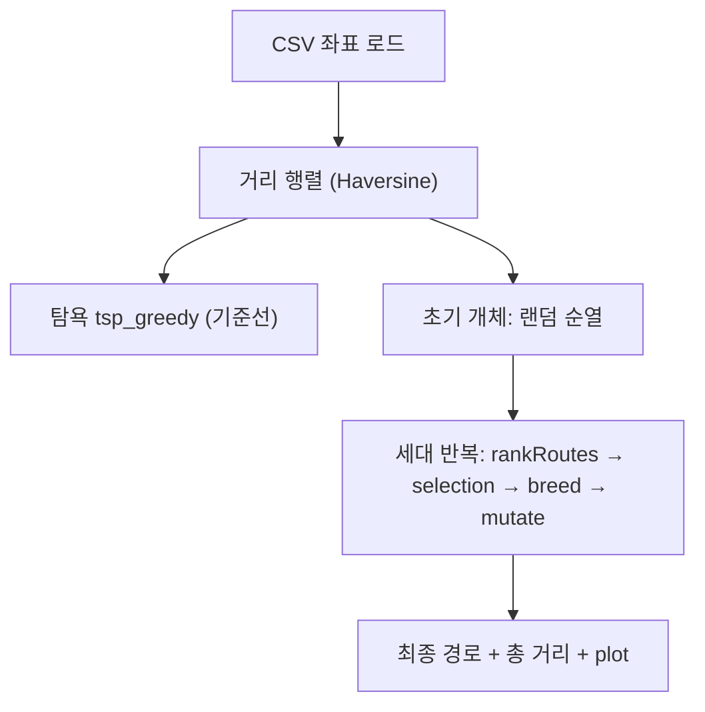

# Genetic algorithm — Task 2

> **Genetic** 알고리즘을 활용한 과제: 

---

## 1. TSP(Traveling Salesman Problem)이란?

- 지점이 n개 있을 때, **각 지점을 정확히 한 번씩** 방문하고 돌아오는 **닫힌 경로(순환)** 중에서  
**총 거리(또는 비용)가 최소**가 되는 순서를 찾는 조합 최적화 문제예요.
- 지점 수가 조금만 많아져도 경우의 수가 폭발해서, **정확히 다 찾기**는 어렵고  
**휴리스틱·메타휴리스틱(탐욕, GA, …)** 으로 좋은 해를 찾는 경우가 많아요.

---

## 2. 이 노트북은 어떻게 푸나요? (손으로 구현한 GA)

- 좌표 CSV를 읽고, 지점 간 **거리 행렬**을 만든 뒤  
**경로 = 도시 순열(permutation)** 로 인코딩합니다. (Task 1의 비트열 인코딩과 다름.)
- **개체** = “어느 순서로 배송할지” 한 줄짜리 경로.
- **적합도**는 총 거리의 **역수**에 가깝게 설계되어, **거리가 짧을수록 적합도가 크도록** (`Fitness.routeFitness` — 노트북에서 `1/거리` 형태로 랭킹).
- 선택은 **엘리트 + 룰렛(roulette)** 스타일, 교차는 한 구간을 부모1에서 가져오고 나머지를 부모2 순서로 채우는 **순열용 교차(`breed`)**, 변이는 **스왑 돌연변이(`mutate`)**.
- 앞부분에는 같은 데이터로 **거리 행렬 + 탐욕 기준선(`tsp_greedy`)** 도 있어서, GA 결과와 비교·시각화하기 좋게 되어 있어요.

---

## 3. 데이터와 거리

- CSV 컬럼 예: 위도·경도, 지점 **인덱스** (`Longitude (deg)`, `Latitude (deg)`, `Index` 등 — 실제 헤더는 파일 기준).
- 노트북 앞에서는 **이중 루프 + Haversine(구면 거리)** 로 n \times n **거리 행렬**을 직접 채웁니다.
- 후반 `City` 클래스에서는 `haversine` 라이브러리로 두 점 사이 거리(미터)를 계산하기도 합니다.
- **로컬 실행 시:** 원래 Colab에서 `pd.read_csv("Atlanta.csv")` 등 **같은 폴더에 CSV**를 두거나, 경로를 수정해야 합니다.

---

## 4. 하이퍼파라미터 (노트북에서 쓰는 예시)

`geneticAlgorithm(...)` 호출 예:

| 이름             | 예시 값 | 직관                     |
| -------------- | ---- | ---------------------- |
| `popSize`      | 200  | 개체(경로) 개수              |
| `eliteSize`    | 20   | 다음 세대로 그대로 가져올 상위 경로 수 |
| `mutationRate` | 0.01 | 스왑 돌연변이 확률             |
| `generations`  | 500  | 세대 반복 횟수               |

(출력에 나오는 “Initial distance / Final distance”는 노트북이 적합도를 거리로 다시 환산해 출력하는 방식입니다.)

---

## 5. 코드 구조 — 함수·클래스 (요약)

| 이름                                     | 역할                                |
| -------------------------------------- | --------------------------------- |
| `tsp_greedy(distances)`                | 거리 행렬 기준 **탐욕** 기준선 경로            |
| `compute_total_distance(matrix, path)` | 한 순열의 **총 거리**                    |
| `City`                                 | 좌표 보관, `haversine`으로 다른 도시까지 거리   |
| `Fitness`                              | 경로에 대해 **routeFitness** (짧을수록 좋게) |
| `createRoute` / `initialPopulation`    | 무작위 순열로 초기 개체 집단                  |
| `rankRoutes`                           | 경로별 적합도 순위                        |
| `selection` / `matingPool`             | 부모 선택                             |
| `breed` / `breedPopulation`            | 순열 **교차**                         |
| `mutate` / `mutatePopulation`          | **스왑** 변이                         |
| `nextGeneration`                       | 한 세대 진행                           |
| `geneticAlgorithm`                     | 전체 루프 + 시작/끝 거리 출력                |
| `geneticAlgorithmPlot`                 | 세대별 진행을 모아 **그래프**용               |

---

## 6. 구조 다이어그램 및 실행

CSV 읽기
  → 거리 행렬 계산
  → (선택) tsp_greedy 로 기준 거리/경로
  → City 리스트 구성
  → initialPopulation → [세대 반복] rankRoutes → selection → breed → mutate
  → 최종 bestRoute + 거리 출력 + 경로 시각화

---

## 8. 결과

- 선택한 도시의 **배송 지점 산점도** + 인덱스 라벨  
- **탐욕 경로** / **GA 경로** 의 총 거리 및 **지도상 경로 플롯**  
- (옵션) `geneticAlgorithmPlot` 로 **세대에 따른 거리 감소** 추이

---

